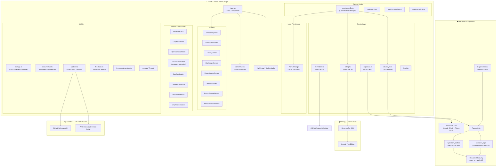
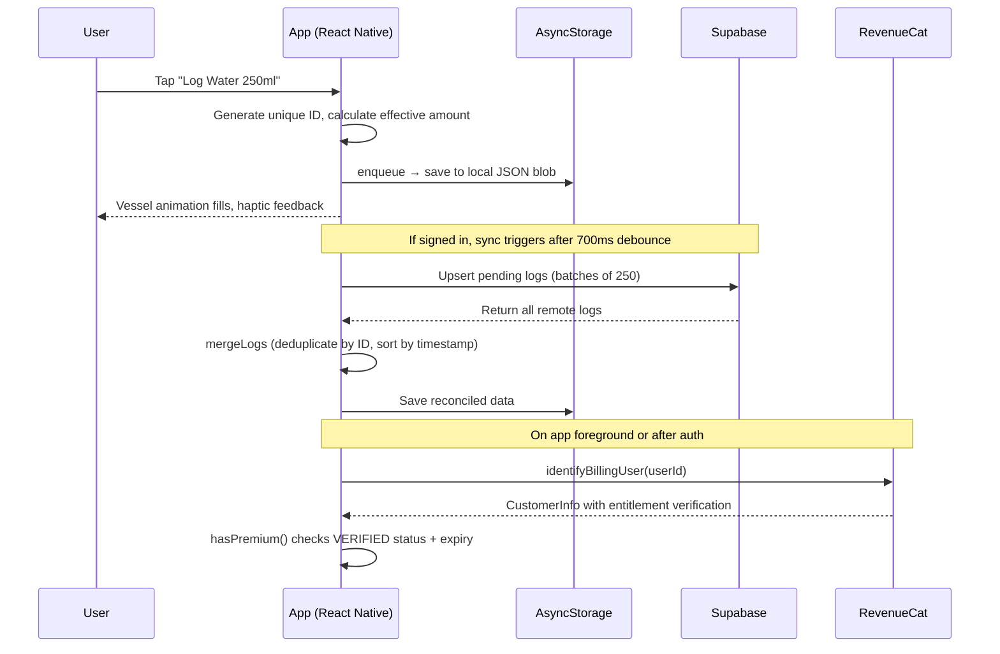

<p align="center">
  
</p>

<h1 align="center">Brownie Water Tracker 💧</h1>

<p align="center">
  A playful hydration tracker starring Brownie the capybara and friends.<br/>
  Built with Expo SDK 58 · React Native 0.88 · React 19 · TypeScript · Supabase
</p>

---

# 📱 For Users

## What Is Brownie?

Brownie Water Tracker is a mobile app that helps you **drink enough water every day** — without it feeling like a chore. You set your personal goal, tap to log drinks throughout the day, and watch a cute capybara named Brownie celebrate your progress. It's simple, ad-free, and fun.

## How It Works

1. **Open the app** → A short onboarding asks about your body, activity level, and climate to calculate the right daily water goal for you (1,000–6,000 ml).
2. **Log drinks** → Tap a beverage icon (water, tea, coffee, juice, milk, etc.) and pick a cup size. Done in one second.
3. **Track progress** → A beautiful animated vessel fills up as you drink. When you hit your goal, Brownie celebrates with a special animation.
4. **Build streaks** → The calendar and streak counter help you stay consistent day after day.
5. **Stay reminded** → Smart reminders nudge you during waking hours, respecting your sleep schedule.

## Features at a Glance

| Feature | What It Does |
|---------|-------------|
| **Personalized Goal** | Calculates your ideal intake from weight, activity, and climate |
| **13 Beverages** | Water, green tea, herbal tea, coffee, espresso, juice, smoothie, milkshake, milk, electrolyte, soda, cold drink, alcohol |
| **Smart Hydration Math** | Not all drinks hydrate equally — coffee counts 80%, alcohol *dehydrates* at −50% |
| **Daily History** | See what you drank, when, and how much — day by day |
| **Streak Tracking** | Consecutive days of hitting your goal |
| **Hydration Calendar** | Monthly view of which days you reached your target |
| **Hydration Challenges** | 10-day themed challenges like "Caffeine-Free Capy" or "Morning Wakeup Glass" |
| **6 Mascots** | Brownie (free), plus 5 Pro mascots: Dotti the Dodo, Manny the Mammoth, Sid the Sloth, Turbo the Turtle, Pip the Penguin |
| **Interactive Brownie** | Tap Brownie's ears, face, belly — each gets a unique animated reaction with sound |
| **Pool Party** | An animated pool scene with all the mascots |
| **Smart Reminders** | Scheduled during your waking hours, respects sound settings |
| **ml & fl oz** | Switch between metric and imperial anytime |
| **Cloud Backup** | Sign in with Google or phone to back up your data to the cloud |
| **Auto Updates** | (GitHub APK) The app checks for new versions and can download and install them |
| **No Ads** | Ever. The app is supported by optional Pro subscriptions |

## Free vs Pro

| | Free | Pro |
|--|------|-----|
| Water tracking | ✅ | ✅ |
| All 13 beverages | ✅ | ✅ |
| Reminders | ✅ | ✅ |
| History & streaks | ✅ | ✅ |
| Cloud backup | ✅ | ✅ |
| Brownie mascot + interactions | ✅ | ✅ |
| 5 additional mascots | 1-min trial | ✅ |
| Challenges | ✅ | ✅ |

Pro is a subscription through Google Play. No ads, no tracking — just extra mascots.

## Download

Download the latest Android APK from [GitHub Releases](https://github.com/mrAbhimanyuVishwakarma/Water-Tracker/releases).

> [!NOTE]
> The APK is for ARM64 Android devices and x86_64 emulators. Android may ask you to allow installation from unknown sources. On Samsung, Auto Blocker can prevent sideloading — the app provides plain-language instructions. See [GitHub APK updates](docs/GITHUB_APK_UPDATES.md).

## Website

Visit the [Brownie website](https://watertrackerbrownie.vercel.app) to learn more, see the mascots in action, and find donation/support links. The site includes a working drink log demo, animated phone preview, and a Free vs Pro comparison.

## Your Data & Privacy

- All drink logs are stored **on your device** by default — nothing leaves your phone unless you sign in.
- Cloud backup is **optional** and uses Supabase with Row Level Security — only you can access your data.
- Health profile fields (weight, conditions, medication notes) are **optional** and never used for analytics.
- Account deletion permanently removes all cloud data.
- The app does **not** diagnose conditions or replace medical advice.

## User Profile

You can optionally fill in a health profile (name, gender, weight, height, health conditions, medication notes, appointment notes). This personalizes your goal calculation and stays local unless you enable cloud backup.

---

# 🛠 For Developers

## System Design Overview

This section explains the architecture, design patterns, and system design concepts used throughout the codebase, written for a developer onboarding onto the project.

### Architecture Diagram



### System Design Concepts Used

```mermaid
flowchart TD
    ROOT["System Design Concepts\nin Brownie Water Tracker"]

    ROOT --> ARCH["🏗 Architecture"]
    ROOT --> DATA["💾 Data Management"]
    ROOT --> AUTH_SEC["🔐 Auth & Security"]
    ROOT --> BILLING_SYS["💳 Billing & Monetization"]
    ROOT --> UX_PERF["⚡ UX & Performance"]
    ROOT --> INFRA["🚀 Infrastructure"]

    ARCH --> MONO["Monolithic SPA\n(Single App.tsx root,\nmanual screen state)"]
    ARCH --> HOOKS_ARCH["Hooks-Based Architecture\n(useAccountData is the\ncentral state controller)"]
    ARCH --> SERVICE_LAYER["Service Layer Pattern\n(supabase.ts, cloudSync.ts,\nbilling.ts, reminders.ts)"]
    ARCH --> OFFLINE["Offline-First Design\n(Local storage is source of truth,\ncloud sync is optional)"]

    DATA --> LOCAL["Local Persistence\n(AsyncStorage JSON blobs\nkeyed by user ID)"]
    DATA --> IMMUTABLE["Immutable Log Append\n(Drink logs are never edited,\nonly appended)"]
    DATA --> MERGE["Deterministic Merge\n(mergeLogs deduplicates by ID,\nsorts by timestamp)"]
    DATA --> RECONCILE["Optimistic Concurrency\n(reconcileSync checks\nsettingsRevision to detect\nlocal edits during sync)"]
    DATA --> QUEUE["Serial Mutation Queue\n(enqueue ensures writes\nnever interleave)"]
    DATA --> MIGRATION["Schema Migration\n(safeSettings fills defaults\nfor old/missing fields)"]

    AUTH_SEC --> PKCE["PKCE OAuth Flow\n(Google sign-in via\nSupabase + expo-web-browser)"]
    AUTH_SEC --> PHONE_OTP["Phone OTP\n(SMS verification\nvia Supabase Auth)"]
    AUTH_SEC --> RLS_SEC["Row Level Security\n(Every DB row scoped to\nauth.uid — no server trust)"]
    AUTH_SEC --> NO_CLIENT_PREMIUM["No Client-Writable Premium\n(DB CHECK constraint blocks\nisPremium in settings JSONB)"]
    AUTH_SEC --> SESSION["Session Management\n(Auto-refresh on app foreground,\nstop on background)"]
    AUTH_SEC --> ACCT_DELETE["Hard Account Deletion\n(Edge Function + CASCADE\n+ local credential wipe)"]

    BILLING_SYS --> RC_SDK["RevenueCat SDK\n(Wraps Google Play\nBilling Library)"]
    BILLING_SYS --> ENTITLEMENT["Entitlement Verification\n(VERIFIED or VERIFIED_ON_DEVICE\nrequired for premium)"]
    BILLING_SYS --> SERIAL_BILLING["Serial Billing Queue\n(billingOperation prevents\nrace conditions)"]
    BILLING_SYS --> TRIAL["Time-Limited Trial\n(1-min mascot preview,\nsingle use, client-timed)"]

    UX_PERF --> REANIMATED["Reanimated Animations\n(60fps native thread\nfor vessel fill, gestures)"]
    UX_PERF --> GESTURE["Gesture Handler\n(Pan, tap, long-press on\nBrownie character)"]
    UX_PERF --> HAPTIC["Multi-Sensory Feedback\n(expo-haptics + expo-audio\nper interaction type)"]
    UX_PERF --> HYDRATION_MATH["Domain-Specific Math\n(hydrationMultiplier per\nbeverage type, −0.5 to 1.0)"]
    UX_PERF --> PERSONALIZATION["Goal Personalization\n(weight × 35ml + activity +\nclimate adjustments)"]
    UX_PERF --> REDUCE_MOTION["Accessibility\n(Reduce Motion respected,\naccessibility labels on\nhit regions)"]

    INFRA --> CNG["Continuous Native Generation\n(No ios/android in git,\ngenerated by Expo at build)"]
    INFRA --> EAS_BUILD["EAS Build Profiles\n(preview, github-apk,\nproduction — each with\ndifferent permissions)"]
    INFRA --> GH_UPDATER["GitHub Self-Update\n(Version comparison,\nAPK download, intent install)"]
    INFRA --> DEEP_LINK["Deep Linking\n(browniewater:// scheme\nfor OAuth callback)"]
    INFRA --> WEBSITE["Static Website\n(Vanilla HTML/CSS/JS\non Vercel, independent deploy)"]
```



### Key Design Decisions Explained

#### 1. Offline-First with Optional Cloud Sync

The app works **100% offline**. All data lives in `AsyncStorage` as JSON blobs keyed by user ID (`@brownie_v2:guest` or `@brownie_v2:<uuid>`). Cloud sync only activates when a user signs in. This means:

- **Zero onboarding friction** — no account required to start tracking.
- **No data loss** — even if the server goes down, local data is safe.
- **Sync is additive** — the `mergeLogs()` function deduplicates by log ID and sorts by timestamp. Logs are immutable and append-only, so merging is always safe.

#### 2. Serial Mutation Queue (No Race Conditions)

All local writes go through `enqueue()` in `useAccountData`. This is a **promise chain** — every mutation waits for the previous one to finish. This prevents:

- Two rapid drink taps from interleaving their AsyncStorage writes.
- A sync response from overwriting a drink logged during sync.
- Settings changes from being lost during concurrent save operations.

The `reconcileSync()` function handles the case where the user edits settings while a sync is in flight — it checks `settingsRevision` to decide whether to keep local or cloud settings.

#### 3. Security: No Client-Writable Premium Flag

The database has a `CHECK` constraint that **blocks** the client from writing `isPremium`, `is_premium`, or `unlockedCharacters` into the settings JSONB:

```sql
check (not (settings ?| array['isPremium', 'is_premium', 'userAccount', 'unlockedCharacters']))
```

Premium status is derived **only** from RevenueCat's entitlement verification (server-signed). The `backupSettings()` utility strips these fields before any cloud write.

#### 4. Row Level Security (Every Row is Scoped)

Both database tables enforce RLS policies so that **every query is automatically filtered to the signed-in user**:

```sql
create policy profiles_select_own on hydration_profiles for select
  using ((select auth.uid()) = user_id);
```

There is no admin endpoint, no shared data, no way for User A to read User B's logs.

#### 5. PKCE OAuth (Secure Mobile Auth)

Google sign-in uses the **PKCE (Proof Key for Code Exchange)** flow instead of implicit tokens. The code verifier is generated client-side, the authorization code is exchanged server-side, and the session is stored in AsyncStorage with auto-refresh tied to the app's foreground/background lifecycle.

#### 6. Immutable Logs with Idempotent Upsert

Drink logs are **never updated or deleted** by the client. Each log gets a unique ID (`timestamp_randomString`). The cloud sync upserts with `onConflict: 'user_id,id', ignoreDuplicates: true`, making retries safe — uploading the same log twice has no effect.

#### 7. Build Profiles & Permission Separation

Three EAS build profiles serve different distribution channels:

| Profile | `REQUEST_INSTALL_PACKAGES` | Purpose |
|---------|---------------------------|---------|
| `preview` | Allowed | Internal testing |
| `github-apk` | Allowed | GitHub Releases distribution (self-update) |
| `production` | **Blocked** | Google Play (no sideloading permission) |

#### 8. Hydration Multiplier System

Each beverage has a `hydrationMultiplier` (0.7 to 1.0, or −0.5 for alcohol). When you log 200ml of coffee, only 160ml counts toward your goal (`200 × 0.8`). This is stored as `effectiveAmount` alongside the raw `amount` in every log — the math is done once at write time, never recomputed.

---

## Tech Stack

| Layer | Technology |
|-------|-----------|
| Framework | Expo SDK 58, React Native 0.88, React 19 |
| Language | TypeScript 6.0 |
| Animations | React Native Reanimated 4.7 |
| Gestures | React Native Gesture Handler 3.3 |
| Local Storage | AsyncStorage |
| Auth & Database | Supabase (PostgreSQL + Auth + Edge Functions) |
| Billing | RevenueCat (react-native-purchases) |
| Notifications | expo-notifications |
| Audio/Video | expo-audio, expo-video |
| Haptics | expo-haptics |
| SVG | react-native-svg |
| Build System | EAS Build (Expo Application Services) |
| Website | Vanilla HTML/CSS/JS on Vercel |

## Project Structure

```text
.
├── App.tsx                  Root component — screen routing, state wiring
├── src/
│   ├── components/          Reusable UI (vessel, dock, slider, Brownie interactions)
│   ├── screens/             Full-screen views (Dashboard, History, Settings, etc.)
│   ├── hooks/               State management (useAccountData, useReminders)
│   ├── services/            External integrations (Supabase, RevenueCat, notifications)
│   ├── constants/           Beverage configs, mascot data, SVG assets
│   ├── types/               TypeScript interfaces & type unions
│   └── utils/               Pure functions (storage, merge, streak, feedback)
├── supabase/
│   ├── migrations/          SQL schema (hydration_profiles, hydration_logs)
│   └── functions/           Edge Functions (delete-account)
├── assets/                  Icons, mascot artwork, videos, character sources
├── plugins/                 Expo config plugins (e.g., withAndroidArchitectures)
├── scripts/
│   ├── dev/                 Local dev helpers
│   ├── media/               Offline character & website media prep
│   ├── qa/                  Android runtime smoke checks
│   ├── release/             Build configuration validation
│   ├── windows/             Windows launchers and device helpers
│   └── legacy/              Historical one-off tools
├── tests/                   Automated regression tests
├── website/                 Public website (independent deploy to Vercel)
└── docs/                    Setup guides, QA records, release notes
```

> [!IMPORTANT]
> The `android/` and `ios/` directories are **generated by Expo** (Continuous Native Generation) and excluded from version control. Never edit them by hand — configure native behavior in `app.json` and config plugins.

## Run Locally

Prerequisites: Node.js, npm, and the Android or iOS tools required by Expo.

```bash
git clone https://github.com/mrAbhimanyuVishwakarma/Water-Tracker.git
cd Water-Tracker
npm install
npx expo start
```

Copy `.env.example` to `.env` and fill the public configuration values. Use a development build for Google login, reminders, and purchases — Expo Go does not support those flows. See [Google Play setup](docs/GOOGLE_PLAY_SETUP.md).

## Checks

```bash
npm test              # regression tests
npm run lint          # ESLint
npm run typecheck     # TypeScript (tsc --noEmit)
npx expo-doctor       # dependency diagnostics
```

After installing a candidate APK on an Android test emulator, run `npm run test:android` for native gesture smoke checks. See [character interactions](docs/character-interactions.md).

## Build

```bash
# Internal testing
npx eas-cli@latest build --platform android --profile preview

# GitHub Releases APK (with self-update flow)
npx eas-cli@latest build --platform android --profile github-apk

# Google Play production (no sideload permission)
npx eas-cli@latest build --platform android --profile production
```

## Data Flow Summary



## Website

The [Brownie website](https://watertrackerbrownie.vercel.app) is a standalone HTML/CSS/JS project in `website/`. It deploys independently to Vercel.

Preview locally:

```bash
npm run website:preview
# or
python -m http.server 3000 --bind 127.0.0.1 --directory website
```

See the [website README](website/README.md) and [beginner website guide](docs/development/website-guide.md).

## Documentation Index

- [Google Play Setup](docs/GOOGLE_PLAY_SETUP.md) — Auth, billing, and store configuration
- [GitHub APK Updates](docs/GITHUB_APK_UPDATES.md) — Self-update flow for sideloaded builds
- [Character Interactions](docs/character-interactions.md) — Gesture system and test setup
- [Project Log](docs/PROJECT_LOG.md) — Build history and platform-specific notes
- [Documentation Index](docs/README.md) — Full docs listing
- [Script Reference](scripts/README.md) — All available npm scripts and dev tools

## License

See [LICENSE](LICENSE) for details (MIT).
